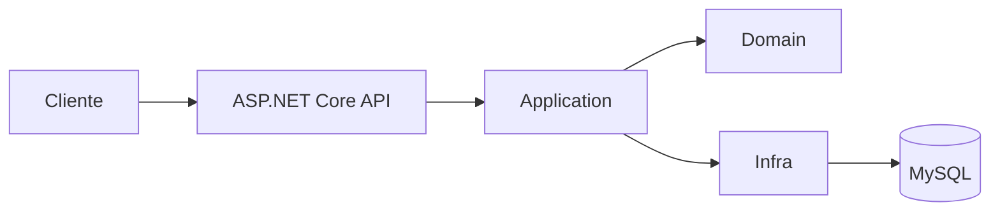
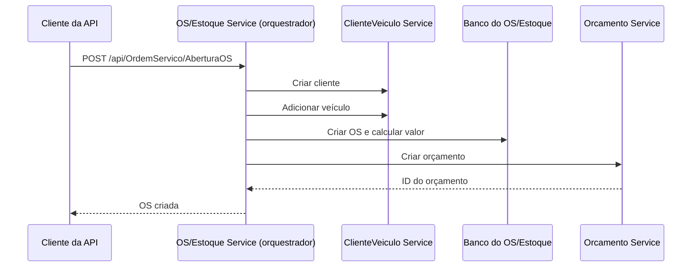
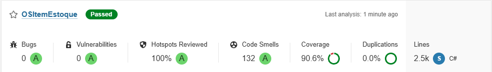
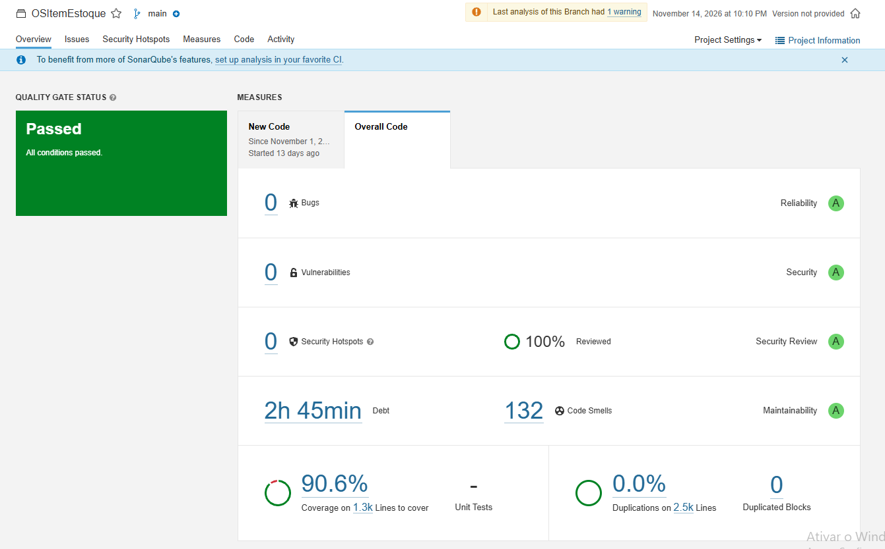

# Serviço de OS e Itens de Estoque

Microsserviço da plataforma Tech Challenge responsável pelas operações de ordens de serviço e itens de estoque.

## Visão geral

A API disponibiliza operações para ordens de serviço e itens de estoque. Os endpoints disponíveis e seus contratos podem ser consultados no Swagger.

## Arquitetura

O serviço segue uma arquitetura em camadas: a API recebe as requisições HTTP, a camada Application coordena os casos de uso, Domain concentra as regras de negócio e Infra implementa persistência e integrações. O projeto IOC registra as dependências.



| Projeto | Responsabilidade |
|---|---|
| `src/OSItemEstoqueService` | API HTTP, controllers e configuração da aplicação |
| `src/Application` | Casos de uso e orquestração |
| `src/Domain` | Entidades, agregados, objetos de valor e regras de negócio |
| `src/Infra` | Persistência e integrações |
| `src/IOC` | Registro e composição das dependências |
| `src/Tests` | Testes automatizados de Application e Domain |

## Saga de abertura da ordem de serviço

A abertura da OS é coordenada por uma Saga orquestrada dentro do OS/Estoque Service. O orquestrador chama os serviços por HTTP síncrono; não há broker de mensagens nesse fluxo.



Se uma etapa falhar, o orquestrador tenta compensar as etapas já concluídas, em ordem inversa:

| Etapa concluída | Compensação |
|---|---|
| Criação do cliente | Inativar cliente |
| Criação do veículo | Inativar veículo |
| Criação da OS | Remover OS |
| Criação do orçamento | Negar orçamento |

As compensações são ações de negócio, não um rollback ACID entre bancos. Se alguma compensação falhar, a aplicação registra o erro e retorna uma exceção agregada com a falha original e as falhas de compensação.

### Aprovação e início da execução

A Saga de abertura termina após criar a OS e o orçamento; ela não fica aguardando aprovação. A aprovação é registrada separadamente no Orcamento Service (`POST /api/Orcamento/AprovarOrcamento`). Quando um mecânico é atribuído para execução (`POST /api/OrdemServico/AtribuirMecanicoEmExecucao`), o OS/Estoque Service consulta `GET /api/Orcamento/OrcamentoAprovado` e só inicia a execução se o orçamento estiver aprovado e não pago. Essa coordenação também é síncrona por HTTP, sem evento de aprovação.

### Escopo e limitações atuais

- O estado e a lista de compensações existem somente durante a requisição; não há persistência da Saga, retomada após reinício, política de retry ou fila de mensagens implementada.
- Se a compensação falhar, é necessária investigação operacional; não há rotina automática de recuperação.
- Se um serviço concluir uma operação, mas a resposta se perder antes que o orquestrador receba o identificador, essa operação remota pode não ter uma compensação registrada.
- O fluxo completo de abertura e compensação tem cenário BDD em [AbrirOS.feature](./src/Tests/Application.Tests/BDD/AbrirOS.feature), com os passos em [AbrirOrdemServicoSteps.cs](./src/Tests/Application.Tests/BDD/AbrirOrdemServicoSteps.cs).

## Tecnologias

- .NET e ASP.NET Core
- MySQL
- Docker e Docker Compose
- GitHub Actions e SonarQube

## Executar localmente

Pré-requisitos: SDK do .NET e Docker com Docker Compose.

```bash
dotnet restore src/OSItemEstoqueSolution.slnx
dotnet run --project src/OSItemEstoqueService/OSItemEstoqueService.csproj
```

Para executar com Docker Compose:

```bash
docker compose -f src/docker-compose.yml up --build
```

## API e documentação

- Swagger UI: `http://localhost:5108/swagger`
- OpenAPI JSON: `http://localhost:5108/openapi/v1.json`
- Verificações de saúde: `/health/live`
- Controllers: `src/OSItemEstoqueService/Controllers`
- Exemplos de requisição: [OSItemEstoqueService.http](./src/OSItemEstoqueService/OSItemEstoqueService.http)

## Testes e cobertura

Para executar a suíte de testes:

```bash
dotnet test src/OSItemEstoqueSolution.slnx --configuration Release
```

O pipeline exige cobertura mínima de 80% de linhas para os testes de Domain e Application.

### Evidência de cobertura

O SonarQube mostra a cobertura de 90,6% na análise do projeto:




### Resultado do teste BDD

O cenário de compensação da Saga foi executado com sucesso. Veja o


[resultado formatado](./src/Tests/Application.Tests/resultado-bdd.txt).

## Docker e Kubernetes

- Dockerfile: [src/Dockerfile](./src/Dockerfile)
- Docker Compose: [src/docker-compose.yml](./src/docker-compose.yml)
- Manifestos Kubernetes: não há manifestos versionados neste repositório. O workflow de deploy reinicia o Deployment `ositemestoque-deployment` no cluster configurado.

## CI/CD

- [CI de branches feature](./.github/workflows/ci-cd-local.yml): build, testes, análise SonarQube e criação de PR para `main`.
- [Deploy da branch main](./.github/workflows/deploy-main-dockerhub.yml): build e publicação da imagem `maquese/ositemestoque` no Docker Hub e atualização do Deployment no Kubernetes.

Configure os secrets e variáveis necessários no GitHub Actions, incluindo credenciais do SonarQube e do Docker Hub.
